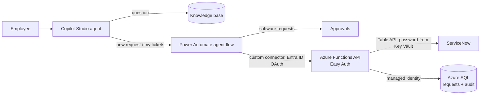

# Enterprise IT Service Desk Copilot

A Copilot Studio agent that answers employees' IT questions from a knowledge base and turns their problems into
ServiceNow incidents. Requests that need sign-off (software) go through a Power Automate approval first. An Azure
Functions API owns the ServiceNow integration and keeps an append-only audit history in Azure SQL.

> **Status:** the API, database schema, Azure infrastructure (Bicep) and custom connector definition are built and
> tested locally. Deployment to Azure, Power Platform and a ServiceNow developer instance is in progress.

## Architecture



1. The agent answers from the knowledge base. When the employee needs help, it classifies the request into a
   category, urgency and impact, and calls the agent flow with the signed-in user's email.
2. The flow calls `SubmitRequest` with the flow run name as `request_id`.
3. Hardware, network, database and general requests become a ServiceNow incident straight away. Software requests
   come back as `pending_approval`; the flow starts an approval and sends the outcome to `DecideRequest`.
4. The API creates the incident with `correlation_id = request_id` and records every step in the audit table.
5. "What's happening with my tickets?" calls `ListRequests`, which returns the employee's last 10 requests with live
   ServiceNow state, assignee and history.

## Design decisions

- **The API enforces approval.** The approval rule lives in the API, so a flow that skips the approval step still
  cannot create a software ticket.
- **Retries never create duplicate tickets.** `request_id` is the primary key, so a retried call finds the existing
  request. One conditional `UPDATE ... OUTPUT` claims the ticket creation, so two concurrent retries create one
  incident; the other gets `503` and retries. If ServiceNow created the incident but the response was lost, the next
  retry finds it by `correlation_id` instead of creating another. A claim abandoned by a crashed instance is picked up
  again after 5 minutes.
- **Errors match Power Automate's retry policy.** A failed ServiceNow call returns `502` and an in-progress claim
  returns `503`, both of which Power Automate retries by default with the same `request_id`.
- **The audit history is append-only.** The app's database role (`servicedesk_app`) can only `SELECT` and `INSERT`
  on `audit_event`, and cannot delete requests. A test proves it.
- **No secrets in Power Platform or app settings.** The connector signs in with Entra ID; Easy Auth accepts tokens
  only from the connector's app registration. The Function App reaches Azure SQL with its managed identity (Entra-only
  authentication) and reads the ServiceNow password through a Key Vault reference.
- **Employees see only their own requests.** `ListRequests` filters by the email of the signed-in Copilot user, and
  the API never exposes ServiceNow tickets that it did not create.

## API

| Operation | Route | Result |
| --- | --- | --- |
| `SubmitRequest` | `POST /api/requests` | `created`, `pending_approval`, `failed` (502) or `creating` (503) |
| `DecideRequest` | `POST /api/requests/{request_id}/decision` | `created` or `rejected`; 404 for unknown requests |
| `ListRequests` | `GET /api/requests?requester=` | Last 10 requests with live state and history |

Categories are `hardware`, `software`, `network`, `database` and `inquiry` (ServiceNow's incident categories);
urgency and impact are 1 (high) to 3 (low). The connector definition is in
[`connector/apiDefinition.swagger.json`](connector/apiDefinition.swagger.json).

## Repository

| Path | Contents |
| --- | --- |
| `api/` | Azure Functions app (Python 3.12) and its tests |
| `sql/schema.sql` | Tables, indexes and the `servicedesk_app` role; safe to run repeatedly |
| `sql/grant_app.sql` | Adds the Function App's managed identity to the role |
| `infra/main.bicep` | Function App (Flex Consumption), Azure SQL (free offer), Key Vault, storage, Application Insights, Easy Auth |
| `connector/` | Power Platform custom connector definition |

## Run the tests

The tests run the real API code against SQL Server 2022 and a fake ServiceNow, as a least-privileged database user:

```sh
docker compose run --rm tests
```

CI runs the same command, builds the Bicep template and validates the connector definition.

## Known limits

- Copilot Studio agent flows must answer within 100 seconds. A paused serverless database can take up to a minute to
  resume, so the first request after a quiet period is slower.
- The Function App and Azure SQL use public endpoints protected by Entra ID. VNet integration with private endpoints
  is the next hardening step.
